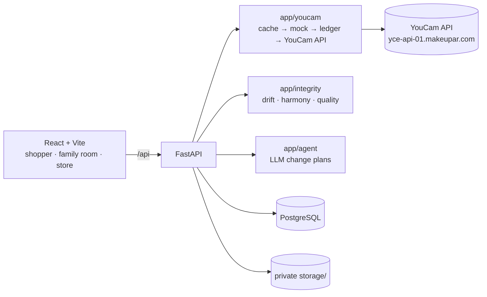

# DearMe


> **Get the whole family's "haan" (yes) before you buy.**
> Multi-layer virtual try-on for South Asian wedding and festive looks: outfit, jewellery, makeup and hair on the shopper's own photo, voted on by the whole family. Built on the YouCam API.

**Live:** https://dearme.koushikdeb.com. The jury demo login is shown on the sign-in page: tap **Fill in**, then **Sign in** (`TestUser` / `TestUser11`). The family voting room never needs a login.

**Status:** milestone M1. See [docs/PROGRESS.md](docs/PROGRESS.md).

## The problem
A wedding or festive look is rarely one person's decision. It is many layers, bought once, often non-returnable, and approved by family. Today that approval happens over WhatsApp screenshots of catalogue models who look nothing like the shopper. Existing virtual try-on is built for one person, one product, one moment. DearMe turns try-on into a **group decision**, so the family can say *haan* (yes) together.

## Works across countries
DearMe supports 11 markets: India, Bangladesh, Nepal, Pakistan, Sri Lanka, UAE, UK, USA, Canada, Australia and Singapore.
- **Each country has its own events.** Examples: Gaye Holud and Bou Bhat in Bangladesh, Baraat and Walima in Pakistan, Haldi and Sangeet in India.
- **Prices are local.** Each market has its own currency, price list and budget presets.
- **Location is detected, then confirmed.** The country is guessed from the browser timezone. "Use my location" snaps to the nearest supported city, and the user can always pick manually.
- **Only the city is stored.** Coordinates are never kept. See [docs/DECISIONS.md](docs/DECISIONS.md) D-003.

## YouCam APIs used
Unit costs come from the live price list; the docs are in [docs/API_NOTES.md](docs/API_NOTES.md).

| Feature | Endpoint | Units | Role in DearMe |
|---|---|---|---|
| Clothes VTO V4 | `/s2s/v2.0/task/cloth-v4` | 2 | Outfit layer |
| Necklace VTO | `/s2s/v2.0/task/2d-vto/necklace` | 1 | Jewellery layer |
| Earrings VTO | `/s2s/v2.0/task/2d-vto/earring` | 1 | Jewellery layer |
| Makeup VTO | `/s2s/v2.0/task/makeup-vto` | 1 | Makeup layer (lip shade swaps) |
| Look VTO | `/s2s/v2.0/task/look-vto` | 2 | Full makeup looks |
| Hairstyle V2.1 | `/s2s/v2.1/task/hair-transfer` | 2 | Hair layer |
| Skin Analysis V2.1 | `/s2s/v2.1/task/skin-analysis` | 9+ | Skin-prep countdown (cosmetic only) |
| Facial Color Tones | `/s2s/v2.0/task/skin-tone-analysis` | 20 | Harmony Score input |
| Fitzpatrick | `/s2s/v2.0/task/fitzpatrick-scale-analyzer` | 10 | Harmony Score input |
| Face Analyzer | `/s2s/v2.0/task/face-attr-analysis` | 10+ | Face shape for jewellery and hair |

## Architecture



## Setup

You need Python 3.11, Node 20 and PostgreSQL 16.

```bash
cp .env.example .env                     # fill in keys; MOCK_MODE=true costs zero units
# Postgres: create role/db 'haan' and 'haan_test', then set DATABASE_URL / TEST_DATABASE_URL

cd backend
python3.11 -m venv .venv && .venv/bin/pip install -r requirements.txt
.venv/bin/alembic upgrade head
.venv/bin/uvicorn app.main:app --reload --port 8000
.venv/bin/pytest -q

cd ../frontend
npm install && npm run dev               # http://localhost:5173 (proxies /api to :8000)
npm test
```

| Script | Purpose |
|---|---|
| `backend/.venv/bin/python scripts/probe/balance.py` | Live unit balance (free) |
| `backend/.venv/bin/python scripts/probe/garment_probe.py [--yes]` | Garment feasibility probe; a dry run unless `--yes` |
| `python3 scripts/claim_lint.py` | Fails on medical or skin-lightening language |
| `bash scripts/deploy.sh` | Test, build and deploy to `/home/Debz/Host/dearme` (Caddy → `127.0.0.1:8160`) |

## Privacy & safety
- Photos, renders and audio are auto-deleted after `IMAGE_RETENTION_HOURS`.
- Location is kept to city level only.
- No skin judgments: cosmetic, appearance-only language, enforced by the claim linter.
- All YouCam, LLM and speech keys stay server-side.

## License
MIT. Demo catalogue images are AI-generated or openly licensed and labelled as such.
