# Render probe results (spec §7.3)

Live YouCam run, 2026-10-11 15:32 UTC. Units: 2032 → 2002.
Demo shoppers are **AI-generated people** (YouCam AI Image Generator), not real individuals. `rendered` = the API returned an image; drape quality is judged by eye in the table.

## Garments (Clothes VTO V4, `full_body`)

| Garment | Model | API | Time | Render | Drape (human) |
|---|---|---|---|---|---|
| Rakta Banarasi Silk Saree | demo_bride | rendered | 32s |  | Pass |
| Sindoor Velvet Bridal Lehenga | demo_bride | rendered | 31s | 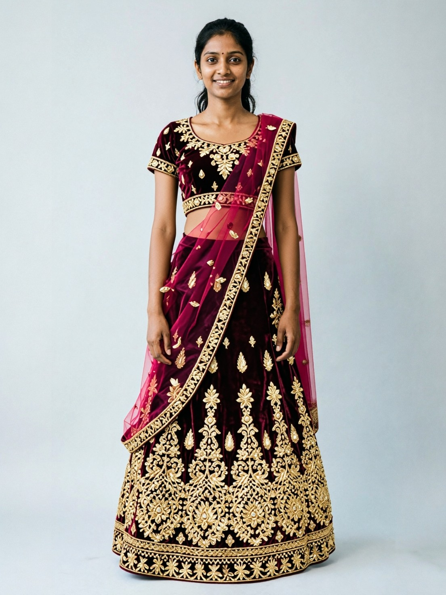 | Pass |
| Genda Phool Haldi Sharara Set | demo_bride | rendered | 30s | 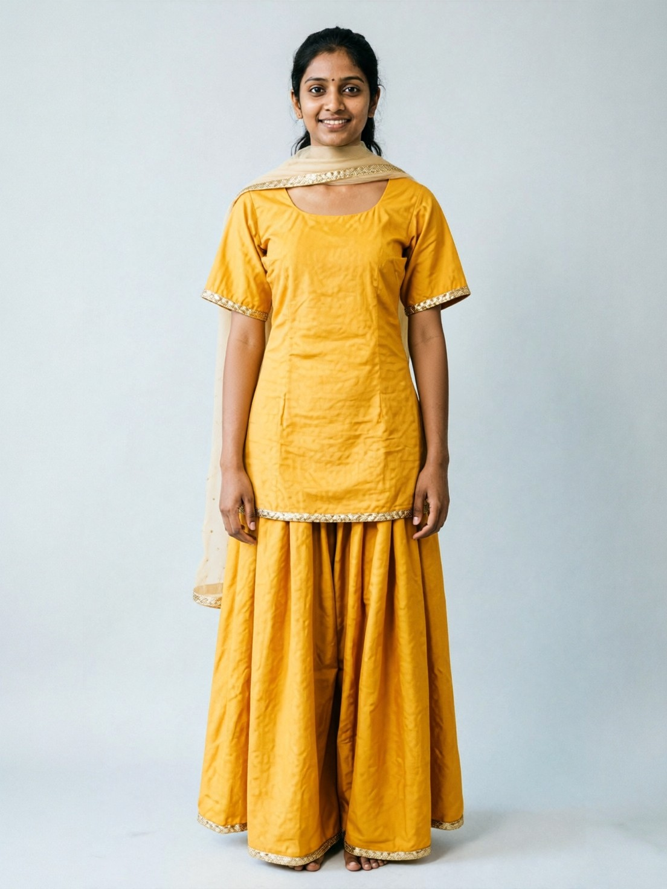 | Pass |
| Gulabi Mirror-work Anarkali | demo_bride | rendered | 29s | 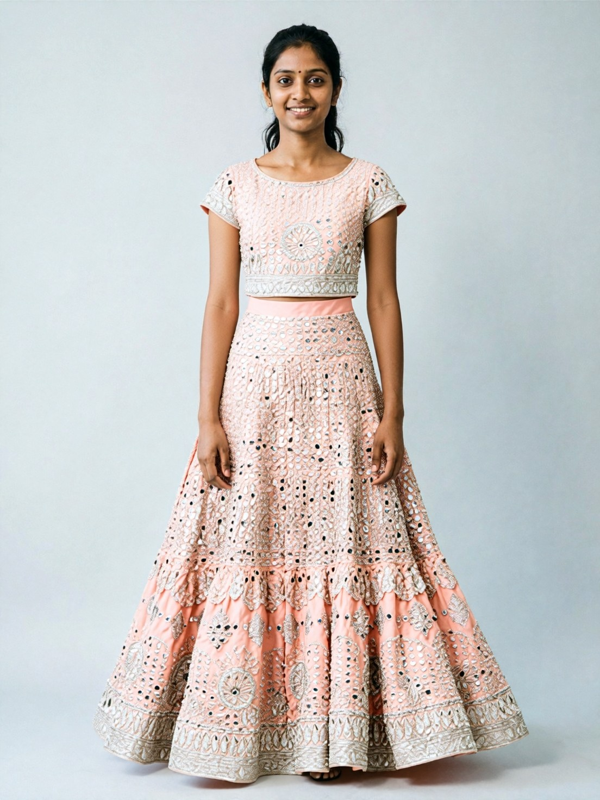 | Pass |
| Zumurrud Embroidered Gharara | demo_bride | rendered | 64s | 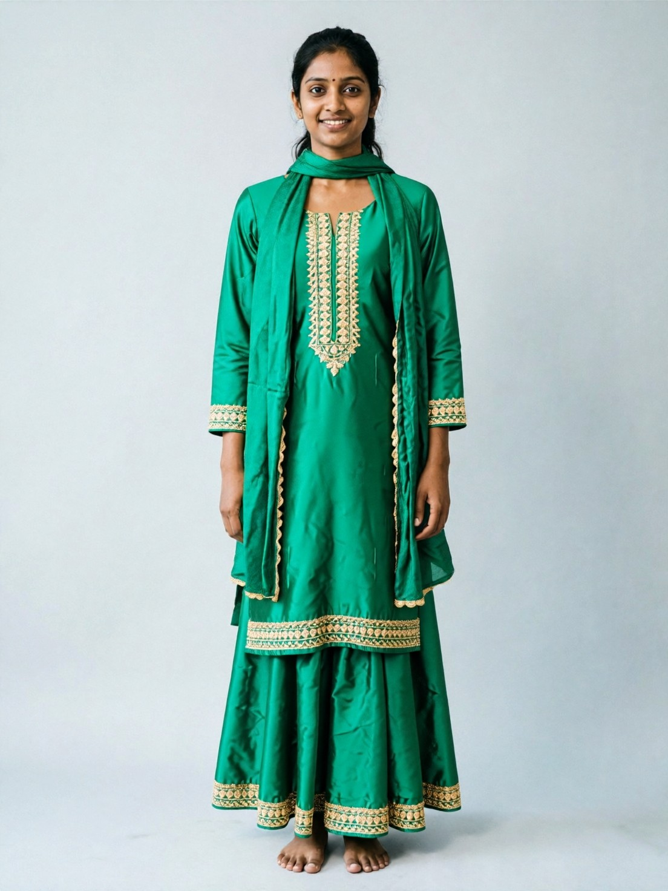 | Pass |
| Moonlace Ivory Bridal Gown | demo_bride | rendered | 68s | 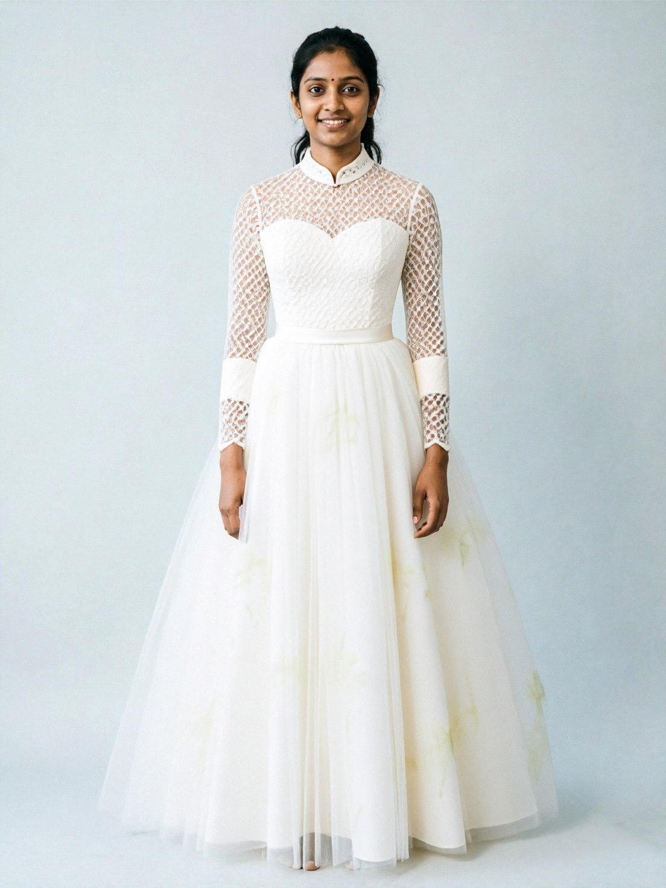 | Pass |
| Kandyan Osariya, White and Gold | demo_bride | rendered | 66s | 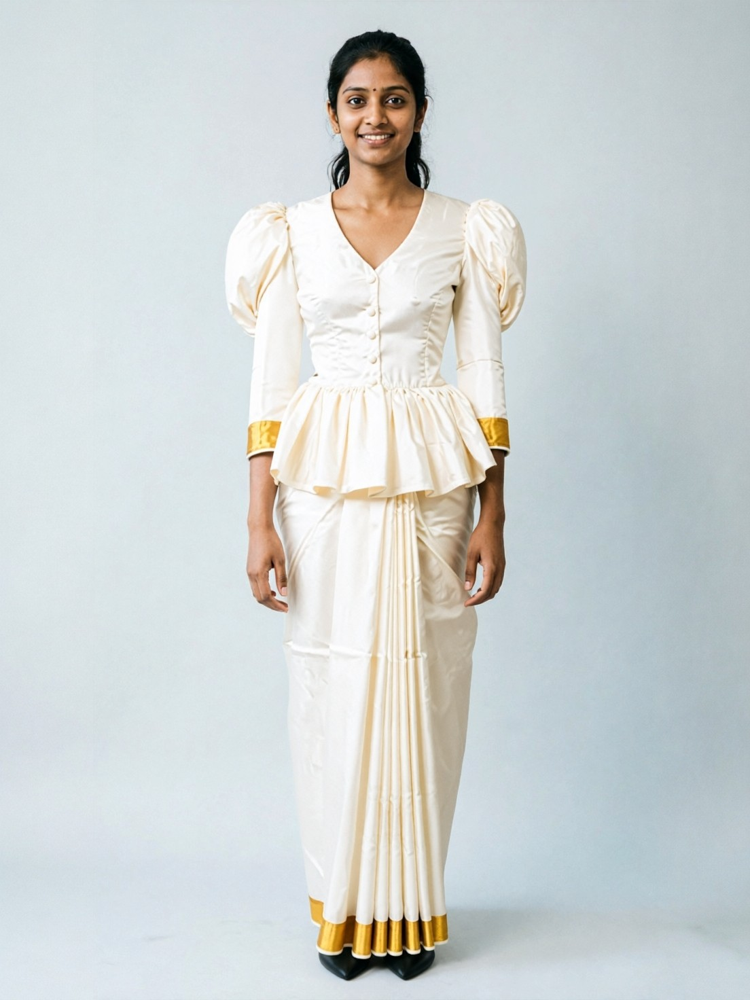 | Pass |
| Raat Ki Rani Sequin Saree | demo_bride | rendered | 75s | 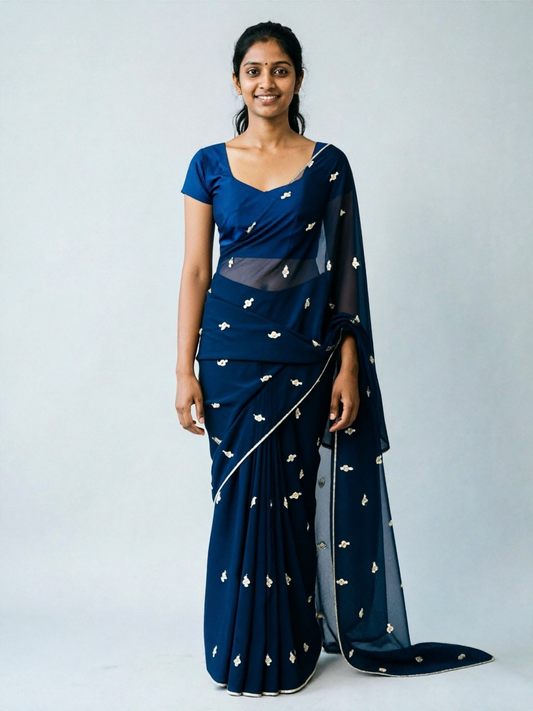 | Pass |
| Shahi Ivory Sherwani | demo_groom | rendered | 98s | 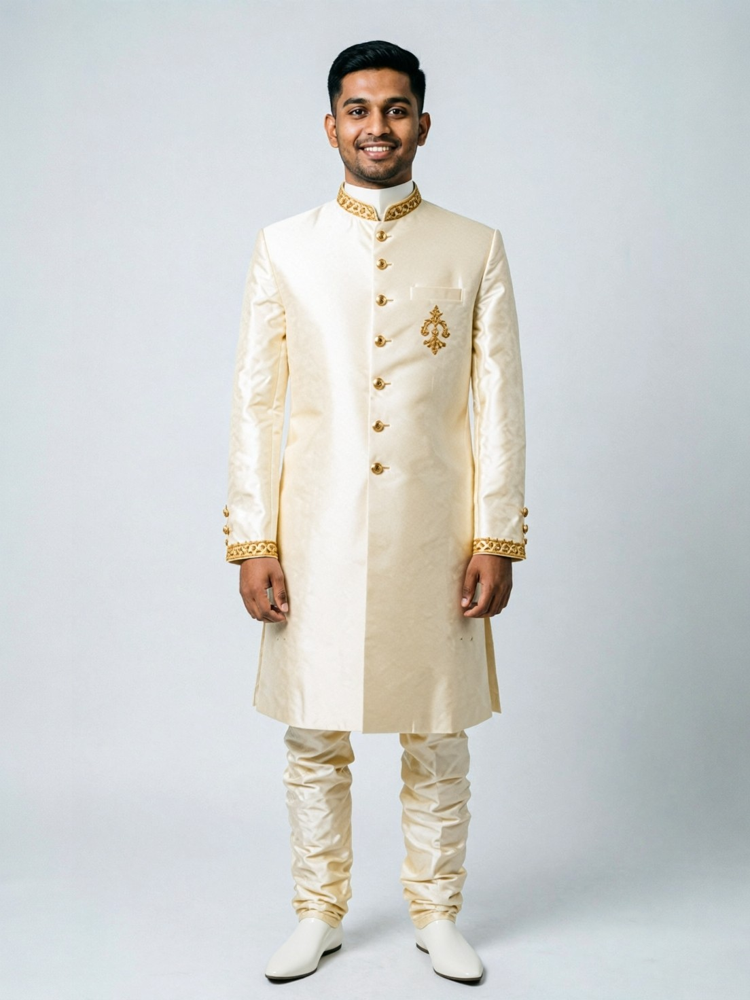 | Pass |
| Maroon Velvet Bandhgala | demo_groom | rendered | 108s | 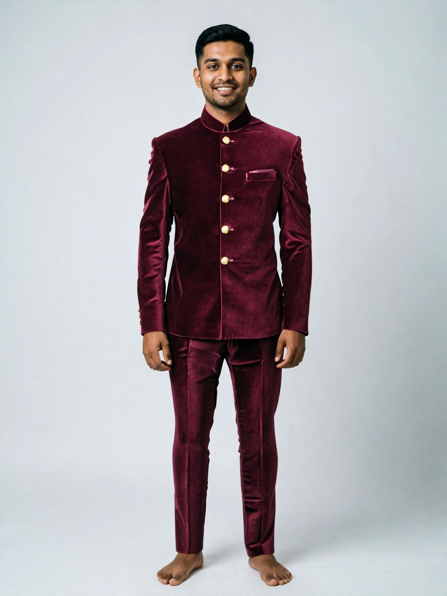 | Pass |
| Haldi Mustard Kurta Pyjama | demo_groom | rendered | 109s | 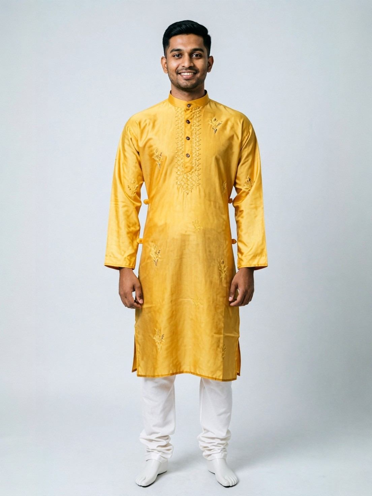 | Pass |
| Classic Black Tuxedo Jacket | demo_groom | rendered | 115s | 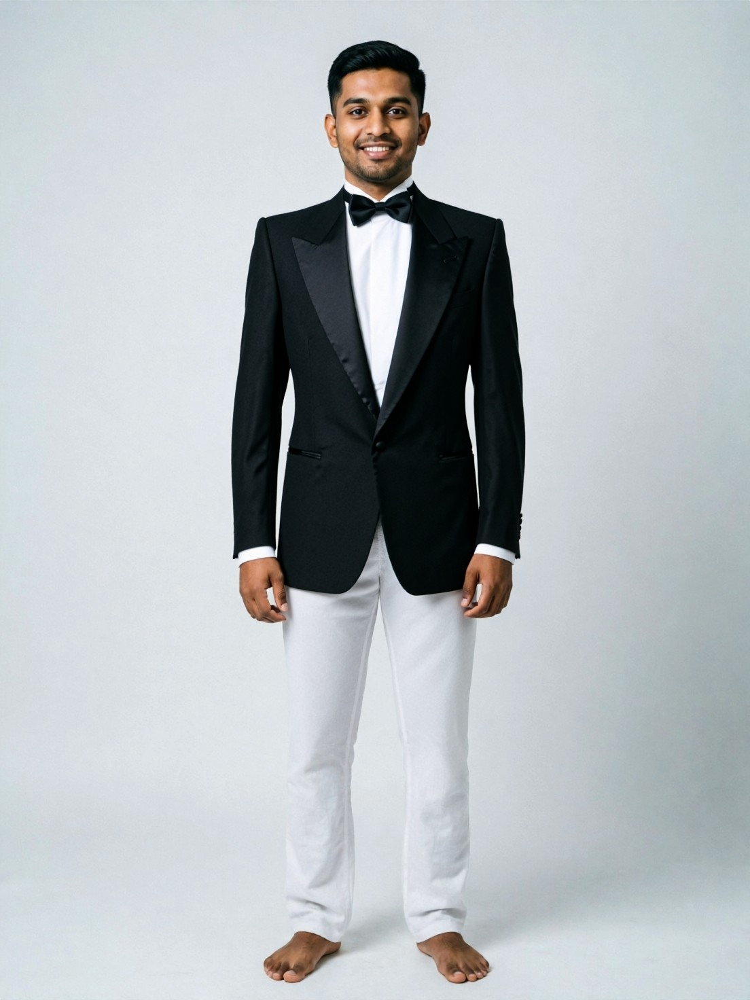 | Pass |

## Bride Chain

| Step | Layer | Result | Time | Image |
|---|---|---|---|---|
| 1 | outfit | rendered | 0s |  |
| 2 | necklace | failed | 6s | 4 |
| 3 | earrings | rendered | 10s |  |
| 4 | makeup | rendered | 14s | 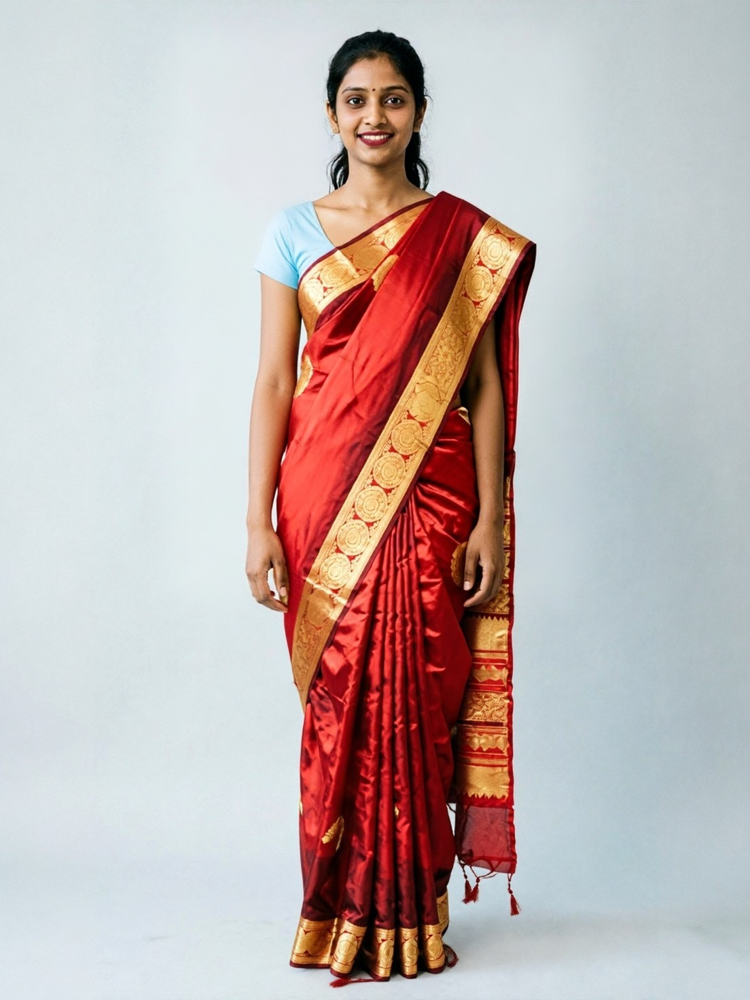 |
| 5 | hair | rendered | 9s | 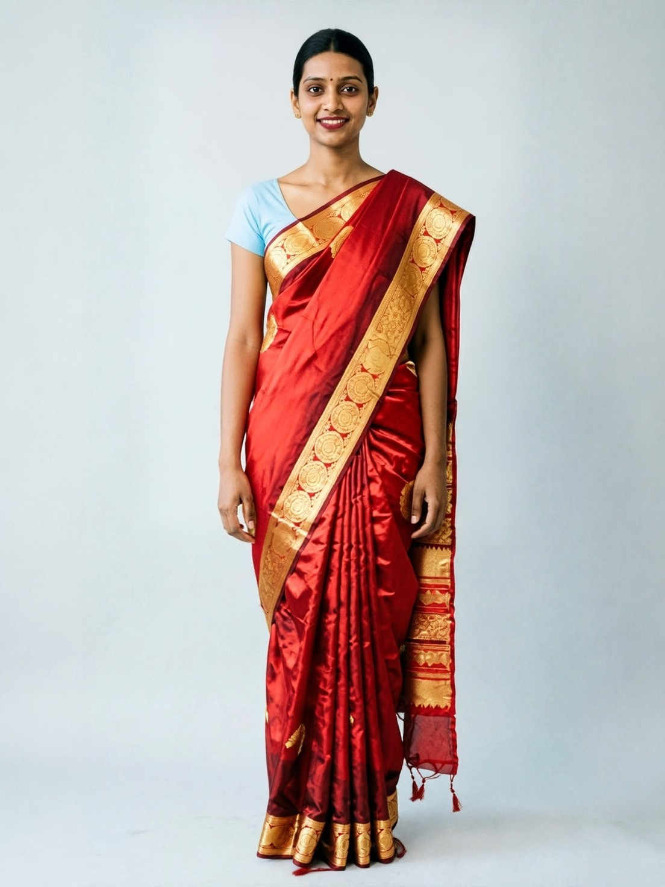 |

## Groom Chain

| Step | Layer | Result | Time | Image |
|---|---|---|---|---|
| 1 | outfit | rendered | 1s |  |
| 2 | hair | rendered | 9s | 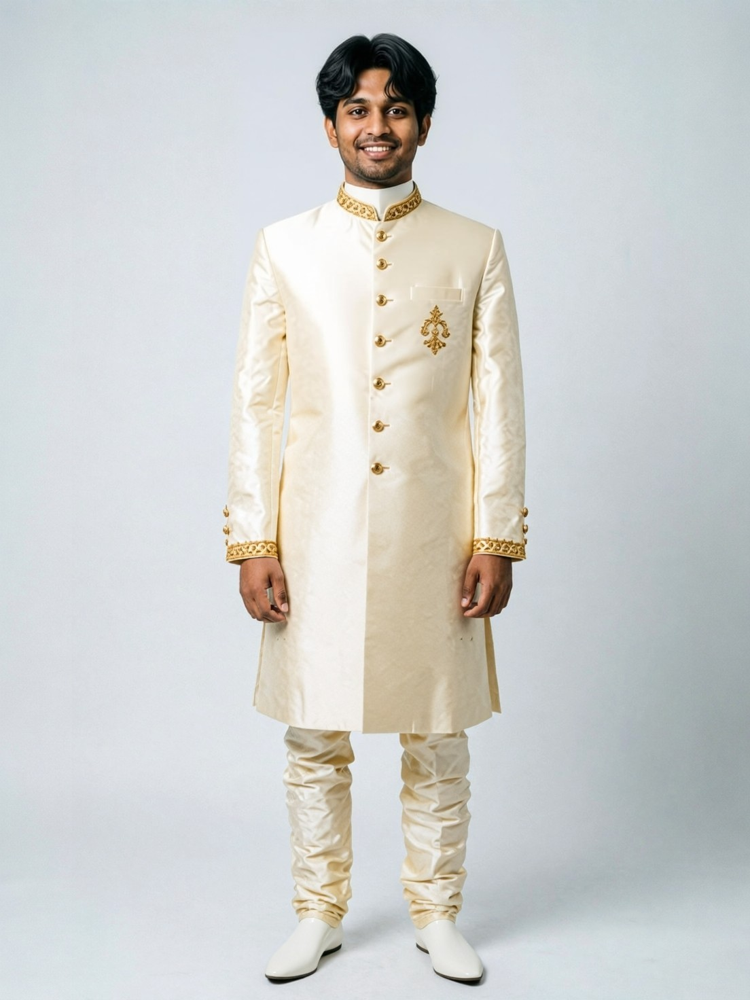 |

## Verdict (reviewed by eye, Oct 11 2026; owner to confirm)
- **All 12 garments drape convincingly** on the AI demo shoppers, including the saree, the lehenga and the Kandyan osariya. The spec §7.3 fallback ("drop saree/lehenga, make jewellery the hero") is **not needed**. One note: on the red saree, the API invented a light-blue blouse because the product image showed no blouse.
- **Necklace, first attempt:** it failed with engine error `4`, "Neck size should be larger and position should be in the center." The head-and-shoulders crop that works for earrings, makeup and hair is too wide for a necklace. Necklaces now use a narrower crop centred on the neck (2.6 face-widths), which rendered the temple necklace correctly on the live retest (`chain_demo_bride_1_necklace.jpg`).
- **Earrings, makeup (Sindoor Dusk) and hair (Sleek Middle Part / Textured Comma)** rendered on the first try. They used the upper-body crop and were blended back into the full-length photo.
- **Timing:** about 30–115 s for each Clothes VTO call, and 6–15 s for each jewellery, makeup or hair call.
