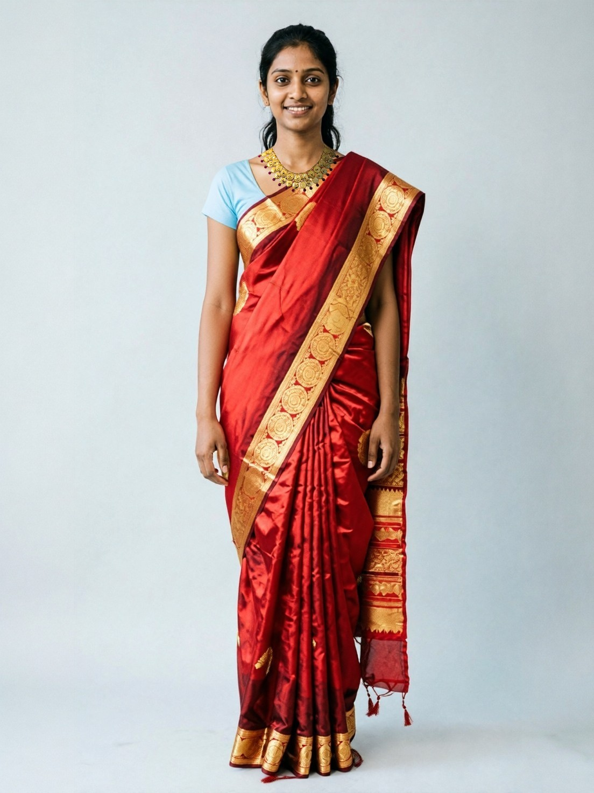
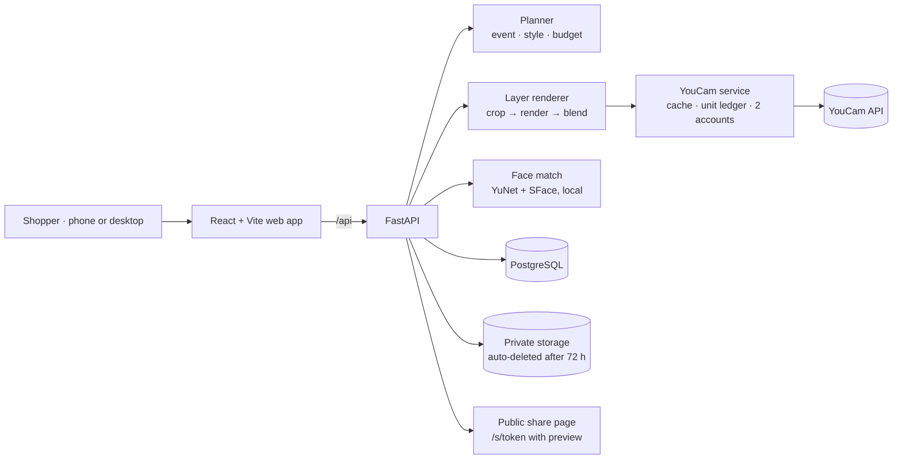

<div align="center">


# DearYou

**Your look. Your family's yes.**

Layered virtual try-on for South Asian wedding and festive looks: outfit, jewellery, makeup and hair, rendered on your own photo with the **YouCam API** and shared with your whole family before you buy.

**[Live app: dearyou.koushikdeb.com](https://dearyou.koushikdeb.com)**  
Demo login: on the sign-in page tap **Fill in**, then **Sign in** (`TestUser` / `TestUser11`).


</div>

---

## The problem

In South Asian families a wedding look is rarely one person's decision. The outfit, jewellery, makeup and hair are bought together, often at high cost and without returns, and the family has to approve them. Today that happens over chat screenshots of catalogue models who look nothing like the bride or groom. Shoppers hesitate, families can't picture the look, and purchases stall or end in regret.

Most virtual try-on handles **one person, one product, one moment**. A wedding look is **many layers, many people, one decision**.

## What DearYou does

1. **Sets up the occasion in under a minute.**
   - Country and city are detected automatically, with a manual override.
   - Each market has its own events, currency and budget presets.
   - The interface is in English, Bengali (বাংলা) or Hindi (हिन्दी).
2. **Takes one photo.**
   - On a phone, "Take my photo" opens the phone's own camera; on a desktop, a guided live camera. Upload works everywhere.
   - A quality check covers light, sharpness, face and framing.
   - **YouCam AI Photo Enhance** can sharpen a soft photo first.
3. **Builds three complete looks** from a real catalogue, ranked for the event, style and budget, and renders them **layer by layer on your photo**: outfit → necklace → earrings → makeup → hair, using five chained YouCam APIs.
4. **Lets you change any layer.**
   - Swap the outfit or a piece of jewellery, change the makeup mood or lipstick shade, pick a hairstyle, or remove and add back a layer.
   - Only the changed layer and the layers after it are re-rendered, and the price against your budget is shown **before** you spend anything.
5. **Handles group photos.** In a couple or family photo, DearYou matches your face close-up to find you, so **only you get dressed** and everyone else stays exactly as they were.
6. **Shares with the family.**
   - One tap shares the look to any chat or social app.
   - The link opens a public page with an image preview, so relatives can reply *haan* (yes), *hmm* or *na*.

## See it work

These are real outputs from the live YouCam pipeline. The people are AI-generated demo models, not real individuals.

**One look, layer by layer** (Clothes → Necklace → Earrings → Makeup → Hairstyle):

| Outfit | + Necklace | + Earrings | + Makeup | + Hair |
|:-:|:-:|:-:|:-:|:-:|
|  |  |  |  |  |

**Garment test:** 12 of 12 garments draped correctly in live testing (full results in [`Codes/docs/probe_results.md`](Codes/docs/probe_results.md)).

| Banarasi saree | Bridal lehenga | Kandyan osariya | Lace gown | Sherwani | Bandhgala |
|:-:|:-:|:-:|:-:|:-:|:-:|
|  |  |  |  |  |  |

## YouCam APIs used

Every call goes through one module, [`Codes/backend/app/youcam/`](Codes/backend/app/youcam/). All endpoints and response shapes were verified against the official docs and live probes, and are recorded in [`Codes/docs/API_NOTES.md`](Codes/docs/API_NOTES.md).

| YouCam API | Endpoint | Units | Role in DearYou |
|---|---|:-:|---|
| **Clothes VTO V4** | `/s2s/v2.0/task/cloth-v4` | 2 | Outfit layer. In group photos it runs on the chosen person only. |
| **Necklace VTO** | `/s2s/v2.0/task/2d-vto/necklace` | 1 | Necklace layer, rendered on a crop centred on the neck. |
| **Earrings VTO** | `/s2s/v2.0/task/2d-vto/earring` | 1 | Earrings layer. |
| **Makeup VTO** | `/s2s/v2.0/task/makeup-vto` | 1 | Three makeup moods plus 10 lipstick shades. |
| **Hairstyle V2.1** | `/s2s/v2.1/task/hair-transfer` | 2 | Hair layer. Recommended styles sit close to the head and keep your own hair colour. |
| **AI Photo Enhance** | `/s2s/v2.0/task/enhance` | 2 | Sharpens the uploaded photo or a finished look, with before/after. |
| **AI Image Generator V2** | `/s2s/v2.0/task/text-to-image/youcam` | 1 | Generated the **entire 24-piece demo catalogue** and the AI demo models. |

## How it works

- **Layered rendering.**
  - Each layer is rendered on the previous layer's output.
  - Face and neck layers are rendered on a high-resolution head-and-shoulders crop that meets each API's size limits, then blended back into the full-length photo with a feathered edge.
  - A failed layer never stops the rest of the look. The user sees why it failed and can retry.
- **Group photos.**
  - YouCam dresses "the largest person in the image".
  - DearYou detects every face (OpenCV YuNet) and matches the face close-up (OpenCV SFace). Both run on the server, so faces are never sent to another service.
  - It then sends YouCam only the strip of the photo that contains the chosen person. When the match isn't confident, the user taps their face; it never guesses.
  - In testing, the other person's pixels were unchanged (mean difference 0.0).
- **Planner.** It ranks catalogue pieces by event, style, jewellery weight, metal and budget. It is deterministic and explainable; no language model chooses products.
- **Cost control.**
  - Each render is cached by content hash; a cached result costs 0 units.
  - A unit ledger records every call.
  - Two YouCam accounts are used in turn, each with its own reserve kept for judging, and a call fails over to the other account if one runs out.
- **Measured performance:** 3 looks × 5 layers (15 renders) completed in about 70 seconds on the live site.



## Works across countries

DearYou covers 11 markets: India, Bangladesh, Nepal, Pakistan, Sri Lanka, UAE, UK, USA, Canada, Australia and Singapore.
- **Local events:** for example Haldi and Sangeet in India, Gaye Holud and Bou Bhat in Bangladesh, Baraat and Walima in Pakistan.
- **Local prices:** each market has its own currency and budget presets.
- **Location:** the country is detected from the browser's time zone or the user's position, and only the nearest city is stored.

## Privacy and safety

- **Retention:** photos, renders and share links are deleted automatically after 72 hours.
- **Location:** stored at city level only; coordinates are never stored.
- **Uploads:** stripped of all metadata, including GPS, and only the owner can view them.
- **Share links:** use unguessable tokens, and only a hash is stored.
- **Language:** no skin judgments. A built-in check blocks medical claims and skin-lightening wording.
- **Keys:** all API keys stay on the server.

## Run it locally

You need Python 3.11, Node 20 and PostgreSQL 16.

```bash
git clone https://github.com/DevDaring/YouCam_Hackathon.git
cd YouCam_Hackathon/Codes
cp .env.example .env            # set DATABASE_URL and secrets; MOCK_MODE=true runs with zero YouCam units
bash scripts/fetch_models.sh    # downloads the open-source face models (Apache-2.0)

cd backend
python3.11 -m venv .venv && .venv/bin/pip install -r requirements.txt
.venv/bin/alembic upgrade head
.venv/bin/uvicorn app.main:app --port 8000      # seeds the demo catalogue and the TestUser account

cd ../frontend
npm install && npm run dev                       # http://localhost:5173
```

To render live, set `MOCK_MODE=false` and `YOUCAM_API_KEY`. A second account, `YOUCAM_API_KEY_2`, is optional.

**Tests:**

| Area | Command | Result |
|---|---|---|
| Backend | `pytest` | 59 |
| Frontend | `npm test` (Vitest) | 81 |
| End-to-end, phone and desktop | `npx playwright test` | 42 |

```bash
cd Codes/backend && .venv/bin/pytest -q
cd Codes/frontend && npm test && npm run build && npx playwright test
```

## Repository layout

```
Codes/
  backend/    FastAPI app: YouCam service, layer renderer, planner, face match, sharing, tests
  frontend/   React + Vite web app (en / hi / bn), Vitest + Playwright tests
  seed/       markets, demo catalogue (AI-generated images), AI demo models
  fixtures/   recorded YouCam responses and live render probes
  docs/       API notes, design decisions, progress log, probe results
  scripts/    deploy, model download, probes, catalogue builder, claim linter
```

## Known limitations

- **No in-app voting room.** Family feedback happens by sharing a look; relatives reply in their chat app.
- **Overlapping people.** When people overlap heavily in a group photo (for example, hugging), the chosen person's strip can include part of someone else.
- **Live rendering speed** depends on YouCam processing time, about 70 s for a full set of three looks.

## Author

**Koushik Deb**, solo team.

## License

**Code.** The source code in this repository is released under the **MIT License**:

```
MIT License

Copyright (c) 2026 Koushik Deb

Permission is hereby granted, free of charge, to any person obtaining a copy
of this software and associated documentation files (the "Software"), to deal
in the Software without restriction, including without limitation the rights
to use, copy, modify, merge, publish, distribute, sublicense, and/or sell
copies of the Software, and to permit persons to whom the Software is
furnished to do so, subject to the following conditions:

The above copyright notice and this permission notice shall be included in all
copies or substantial portions of the Software.

THE SOFTWARE IS PROVIDED "AS IS", WITHOUT WARRANTY OF ANY KIND, EXPRESS OR
IMPLIED, INCLUDING BUT NOT LIMITED TO THE WARRANTIES OF MERCHANTABILITY,
FITNESS FOR A PARTICULAR PURPOSE AND NONINFRINGEMENT. IN NO EVENT SHALL THE
AUTHORS OR COPYRIGHT HOLDERS BE LIABLE FOR ANY CLAIM, DAMAGES OR OTHER
LIABILITY, WHETHER IN AN ACTION OF CONTRACT, TORT OR OTHERWISE, ARISING FROM,
OUT OF OR IN CONNECTION WITH THE SOFTWARE OR THE USE OR OTHER DEALINGS IN THE
SOFTWARE.
```

**Generated assets.** The demo catalogue images and demo models in `Codes/seed/` and the render outputs in `Codes/fixtures/` were generated for this project with the YouCam API. They are included for demonstration and remain subject to Perfect Corp's YouCam API terms of service. They depict no real people or real products. The store name "Utsav House" is fictional.

**Third-party components** keep their own licences:

| Component | Licence | Notes |
|---|---|---|
| MediaPipe BlazeFace face detector | Apache-2.0 | `Codes/backend/app/integrity/models/` |
| OpenCV YuNet and SFace face models | Apache-2.0 | Downloaded by `scripts/fetch_models.sh`; not included in this repository |
| Fraunces, Inter, Noto Sans Bengali, Noto Sans Devanagari fonts | SIL Open Font License 1.1 | Loaded from Google Fonts |
| Lucide icons | ISC | |
| Test portrait in `Codes/frontend/e2e/fixtures/portrait.png` | Public domain | NASA, via scikit-image sample data |

**Python and npm dependencies** are used under their respective licences; see `Codes/backend/requirements.txt` and `Codes/frontend/package.json`.

**Trademarks.** YouCam and Perfect Corp are trademarks of Perfect Corp. DearYou is an independent hackathon project built on the YouCam API and is not affiliated with or endorsed by Perfect Corp.
